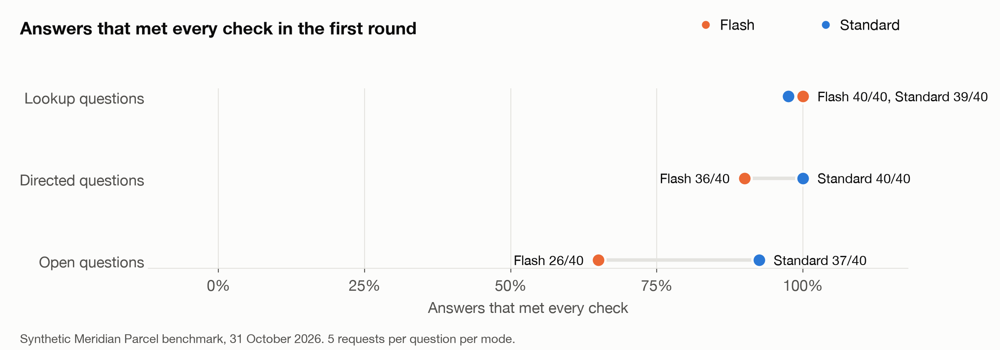
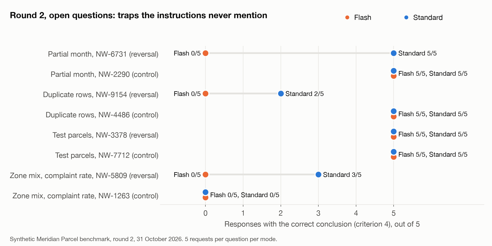

# Thinking, Fast and Slow with Databricks Genie

Companion repo for the article that compares Genie Agent mode **Flash** with **standard Agent mode** (called Standard here). Both modes answered the same 28 questions five times each on a synthetic parcel company, Meridian Parcel. That makes 280 requests in 140 randomized pairs. A blind LLM judge graded every response against four criteria per question.

All data is synthetic. Results are from one run on 31 October 2026.

## Results at a glance

| Question level | Flash pass | Standard pass | Median completion time (Flash / Standard) |
|---|---|---|---|
| Lookup | 40/40 | 39/40 | 8.6s / 9.1s |
| Directed (names the check) | 36/40 (conclusion 40/40) | 40/40 (conclusion 40/40) | 12.0s / 13.1s |
| Open (does not name the check) | 26/40 | 37/40 | 12.4s / 16.5s |
| Missing evidence | 3/20 | 5/20 | 11.9s / 14.4s |

The gap on open questions comes from the delivery case. There, the overall average falls only because the zone mix shifts. On NW-4127, Standard reported that both zones got slower in 4 of 5 runs. Flash never did. In one run Flash split the on-time rate by zone and mentioned the mix, but it still said delivery got faster. Full numbers are in `results/summary.json`.



### Round 2 (harder, pre-registered)

The round 2 answer key and data were committed (584272a) before any round 2 request ran. 200 requests, 20 questions:

- Part A asked the round 1 complaint and refund open questions of an agent whose instructions do not define complaint rate or refund rules. Flash passed 19/20 and Standard 20/20, so the instructions were not why Flash handled them.
- Part B added four traps the instructions never mention, each with a control: partial month, duplicate load, test parcels, and zone mix on complaint rate.

| Round 2 | Flash | Standard | Median time (Flash / Standard) |
|---|---|---|---|
| Directed, correct conclusion | 38/40 | 40/40 | 14.2s / 15.3s |
| Open, all four checks | 0/40 | 21/40 | 11.2s / 26.3s |
| Open, correct conclusion | 20/40 | 30/40 | |
| Open reversal, partial + duplicate + zone mix, correct conclusion | 0/15 | 10/15 | |

The test parcel trap caught neither mode: both read the `is_test` column comment and excluded test parcels. Full numbers are in `results/summary_r2.json` and `results/analysis_r2.txt`.



## Layout

- `article/draft.md` is the article. `medium/` holds the Medium build script, publish notes and the hero image prompt.
- `sql/01_build_data.sql` builds the seven tables. `sql/02_ground_truth.sql` is the reference SQL. `notes/ground_truth_output.txt` holds its output.
- `runner/answer_key.py` defines the 28 questions, four criteria each, and the answer-key facts. It writes `answer_key.json`. The Genie agent never sees this file.
- `runner/create_agent.py` creates the Genie agent: tables, text instructions and join specs.
- `runner/genie_call.py` makes one Agent mode request over SSE with `execution_mode` set to `FLASH` or `STANDARD`.
- `runner/run_benchmark.py [workers]` runs the 280 requests. It uses seed 20261031, can resume and never retries.
- `runner/judge.py` grades blind packets. They hold no mode, timing or repeat number.
- `runner/analyze.py` writes `results/summary.json`.
- `results/raw.jsonl` holds every response with its SQL and timing. Workspace hostnames are replaced with `<workspace-host>`. `results/grades.jsonl` holds every verdict.
- `notes/` holds the judge audit, the run incident log and the answer-key change log.
- `figures/` and `screenshots/` hold the images used in the article. `figures/make_*.py` regenerate the charts.

## Round 2 files

- `sql/03_build_round2.sql` builds `meridian_parcel_r2` (round 1 data plus 8 networks). `sql/04_ground_truth_round2.sql` and `notes/ground_truth_round2_output.txt` verify it.
- `runner/answer_key_r2.py` defines the 20 round 2 questions. `results/round2_spaces.txt` lists the two round 2 agents.
- `results/raw_r2.jsonl`, `results/grades_r2.jsonl`, `results/summary_r2.json`, `results/analysis_r2.txt`.
- Run round 2 with `KEY=runner/answer_key_r2.json RAW=results/raw_r2.jsonl GRADES=results/grades_r2.jsonl SUMMARY=results/summary_r2.json ADJ=notes/adjudications_r2.json` plus `GENIE_SPACE_R2` and `GENIE_SPACE_NODEFS`. Build the round 2 agent with `MERIDIAN_SCHEMA=meridian_parcel_r2` and the no-definitions agent with `AGENT_VARIANT=nodefs`.

## Run it on your own workspace

You need a Databricks workspace with Genie Agent mode, the Flash preview enabled by an admin, a SQL warehouse, and a Claude (or other chat) serving endpoint for the judge.

```bash
uv venv .venv && uv pip install --python .venv/bin/python databricks-sdk requests matplotlib numpy pillow

export DATABRICKS_CONFIG_PROFILE=<your-profile>
export MERIDIAN_CATALOG=<catalog-you-can-write-to>
export WAREHOUSE_ID=<sql-warehouse-id>

.venv/bin/python sql/run_sql.py sql/01_build_data.sql
.venv/bin/python sql/run_sql.py sql/02_ground_truth.sql      # check the expected values
.venv/bin/python runner/answer_key.py
export GENIE_SPACE_ID=$(.venv/bin/python runner/create_agent.py | head -1)

cd runner
../.venv/bin/python run_benchmark.py 3
../.venv/bin/python judge.py 6        # judge endpoint: JUDGE in judge.py
../.venv/bin/python analyze.py
```

The tables are written to `$MERIDIAN_CATALOG.meridian_parcel`. Change `JUDGE` in `runner/judge.py` if your workspace uses a different endpoint name.

## Limits

- The data is small and synthetic. Each case has one designed check.
- There are eight open questions. Five repeats measure stability, not new problems. The 95% bootstrap interval on the open-question difference is 7.5 to 52.5 percentage points.
- One LLM judge graded all 280 responses. Two full grading passes agree on 276 of 280 verdicts, and three inconsistent verdicts were settled by hand (`notes/adjudications.json`, applied in `runner/analyze.py`). 55 were read by hand and no verdict was overturned (`notes/audit.md`). Answer-key changes are logged in `notes/key_changes.md`, and the Codex review that prompted the last one is in `notes/codex_review.md`.
- Completion time was measured on the client. Cost and token use were not measured.
- Flash is in Beta. Results describe one run on one day.

Disclosure: the author works at Databricks. Opinions are the author's own.
