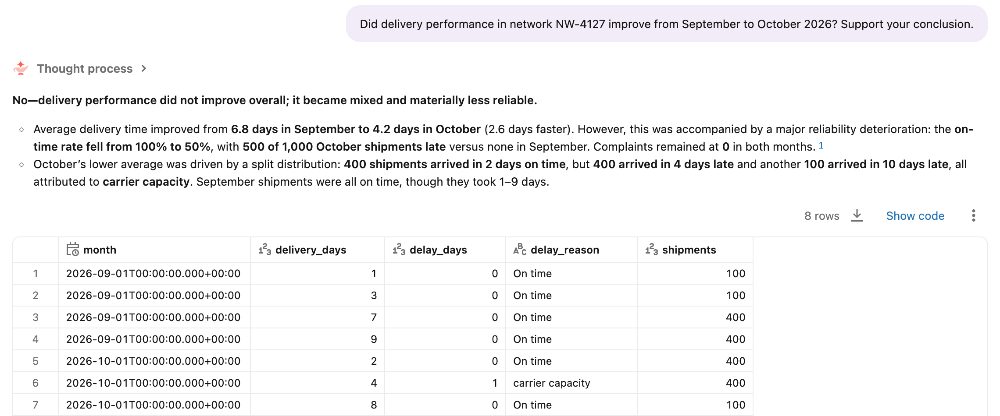
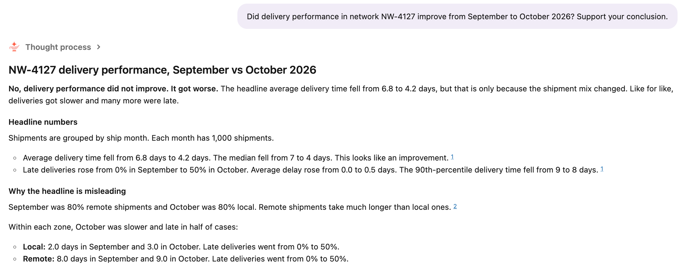
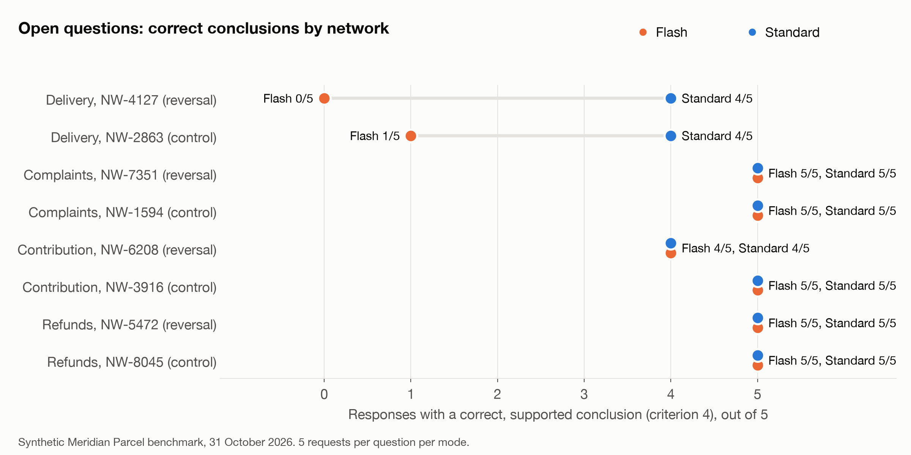

# Thinking, Fast and Slow with Databricks Genie

*Genie now lets you choose between a fast answer and a slower, more careful one. I asked both the same questions to find out when the wait is worth it.*

Praneeth Paikray, 31 October 2026

## What is this article about?

Genie Agent mode can now answer a question in [two ways](https://docs.databricks.com/aws/en/ai-bi/release-notes/2026). If you switch on the lightning button next to Agent, you get Flash, which spends less time reasoning and answers faster. If you leave it off, you get standard Agent mode, which takes longer and checks more. I will call them Flash and Standard.

Databricks [recommends Flash for simpler tasks](https://docs.databricks.com/aws/en/genie-agents/concepts). But my questions don't arrive labelled "simple" or "hard", so I kept wondering what I get when I wait for Standard. Is it a better answer, or only a longer one?

This article is my attempt to find out. I built a small fake company with traps hidden in its data. Then I asked both modes the same questions five times each over two rounds, and compared what they checked, what they concluded and how long they took.

## Where did the idea come from?

Meridian Parcel is a made-up delivery company. In October, its network NW-4127 reports that the average delivery time fell from 6.8 days to 4.2 days. A manager asks whether delivery performance improved.

The quick answer is yes. But if you split the parcels into local and remote deliveries, both got slower. Local went from 2 days to 3, and remote from 8 days to 9. The average fell only because October shipped far more local parcels, which are quick to deliver. The local share went from 20% to 80%.

So the honest answer is no. A careful analyst checks the zones before answering. I wanted to know whether Flash would make that check, and whether Standard would.

## How did I set up the test?

Meridian Parcel has seven tables, from shipments to refund policies. I hid four traps in them. Each trap has a headline number that points the wrong way, and one check that shows the truth:

- In the delivery trap, you have to look at each zone and at the mix of zones.
- In the complaint trap, complaints rise from 40 to 60, but the network shipped twice as many parcels. The complaint rate fell from 4% to 3%.
- In the profit trap, revenue rises from $100,000 to $120,000, but $20,000 of credits went back to customers. Net contribution fell from $30,000 to $20,000. A careless join also counts the credited invoices twice and shows a rise.
- In the refund trap, two policies cover different dates. The right answer uses the policy in force on each shipment's promised date, and weather delays never count.

Each trap also has a control network with the same headline, where the check agrees with it. A good answer should not invent a problem there.

![Table of the four cases. Delivery needs the average by zone and the zone mix. NW-4127's average falls while both zones get slower, and NW-2863's average falls while both zones get faster. Complaints needs the rate per shipment. NW-7351's count rises while its rate falls from 4% to 3%, and NW-1594's rate rises from 4% to 6%. Contribution needs credits and one row per invoice. NW-6208's net falls from $30K to $20K, and NW-3916's rises to $35K. Refunds needs the policy by promised date with weather excluded. NW-5472 has 3 qualifying shipments for $60, and NW-8045 has 6 for $120.](../figures/table-cases.png)

I asked about each network in three ways. A lookup question asks for one number. A directed question names the check. An open question asks what a manager would ask, such as "Did delivery performance in network NW-4127 improve from September to October 2026? Support your conclusion." The open questions are the real test, because nobody tells the agent what to check.

I also added four questions the data cannot answer, such as how many customers had a problem and never complained. That made 28 questions, each sent five times to each mode, for 280 requests. Both modes used the same Genie agent, data and instructions, and every request started a fresh conversation.

## How did I decide which answers were right?

Before the run, I wrote four checks for every question. For the open NW-4127 question, a response had to report the overall average, report each zone's average, explain the mix, and conclude that delivery did not improve. It passed only if it did all four.

A judge model, Claude Opus 5.5 on Databricks, graded every response against those checks without knowing which mode wrote it. I read 55 of the graded responses myself. I also asked Codex to review my work, and it found a mistake in my answer key for one refund question. I fixed it and regraded everything. The repo at the end has every response, every verdict and all three Codex reviews.

## Where did Flash and Standard agree?

In the first round, when the question named the check, both modes reached the right conclusion in all 40 directed responses. Flash sometimes left out the figures behind its answer, so it passed all four checks 36 times against Standard's 40.

On lookups, Flash was perfect at 40 of 40, and Standard passed 39. Standard's one miss shows that extra reasoning can add mistakes too. Asked only for the two averages on NW-4127, it added "Delivery time improved by 2.6 days month-over-month", which is the exact misreading the trap was built to catch.

The complaint and refund traps did not separate the modes at all. Both divided complaints by parcels shipped, and both applied the right refund policy every time. My first guess was that the agent's instructions explained this, because they defined "complaint rate" and spelled out the refund rules. The second round showed that Flash did not need those written definitions.

## Where did they split?

In the first round, they split on the open questions. Standard passed 37 of 40 open responses and Flash passed 26. In 11 pairs Standard passed where Flash failed, and it never went the other way.

Most of that gap is the delivery trap. Here is the first run of each mode on NW-4127. Both took about 25 seconds, and both said no, but for different reasons.

Flash pointed at late deliveries. It found that the on-time rate fell from 100% to 50%, and it stopped there. It never split the parcels by zone.

Standard ran four queries in the same time. It explained that September was 80% remote and October was 80% local, and showed that both zones got slower.

Across five runs, Standard explained the mix shift four times. Flash never reported that both zones got slower. On the control network, where delivery really did improve, Flash said "improved" every time, but in three runs it never checked whether the improvement held in each zone.

On the profit trap, both modes reached the right conclusion four times out of five. Flash kept leaving out the supporting figures. One Standard response fell into the double-counting join and reported $160,000 of revenue instead of $120,000.

Eight open questions is a small sample. A bootstrap over them puts the gap between 7.5 and 52.5 percentage points. The direction is clear. The size is not.

## What happened when I made it harder?

The first round left two things open. The complaint and refund traps never separated the modes, and only one trap needed a check that nobody had written down. So I ran a second round of 200 requests. I committed its answer key to the repo before the first request went out, so I could not tune the checks to the results.

First, I asked the complaint and refund questions again, this time to an agent whose instructions did not define complaint rate or the refund rules. Flash still got 19 of 20 right, and Standard got 20 of 20. Both modes worked out the rate on their own. The refund policy table still describes its rules in its column comments, so this shows the written definitions were not needed. It does not show that Flash needs no guidance at all.

Then I added four new traps that the instructions never mention, each with a control network:

- In the partial month trap, October data for one network stops on 15 October. Volume looks like it fell from 900 to 600, but per day it rose from 30 to 40.
- In the duplicate trap, every October row was loaded twice. Volume looks like it doubled, but there are only 1,000 distinct shipments, the same as September.
- In the test parcel trap, 1,000 one-day internal test parcels pull the October average down to 3.25 days. Real customers waited longer, 5.5 days instead of 5.0.
- In the zone mix trap, the complaint rate rises from 3.2% to 5.8% overall but falls in both zones. The mix moved toward remote parcels, which draw more complaints.

This time the gap was hard to miss. On the open questions, Flash passed 0 of 40 responses and Standard passed 21. On the partial month, duplicate and zone mix traps, Flash reached the right conclusion in 0 of 15 runs and Standard in 10.

Flash usually ran one query and reported what it saw. "Shipment volume in network NW-6731 decreased by 300 shipments, from 900 in September 2026 to 600 in October 2026." On the duplicate network it said volume "doubled". Standard checked the date range in all five runs on NW-6731, found the duplicates in two of five runs, and explained the zone mix in three of five.

The test parcel trap caught no one. Both modes read the description of the is_test column and left the test parcels out on their own.

Standard was not flawless. On the zone mix control, where the complaint rate really did get worse in both zones, Standard twice ran a significance test and declined to call it worse. Flash said "worse" every time, which is the right direction, but it never looked at the zones, so neither mode got credit there.

When the question named the check, the gap mostly closed. Flash reached the right conclusion in 38 of 40 directed responses and Standard in 40. The wait grew, though. On the open questions in this round, Flash took a median of 11.2 seconds and Standard took 26.3.

## Where did both of them fail?

Both modes did badly on the questions the data could not answer. Flash passed 3 of 20 and Standard passed 5 of 20.

Standard claimed that a routing change saved one day in all five runs, with no comparison group to support it. Flash told me "263 customers had a problem with an October 2026 delivery in network NW-1594 but never filed a complaint", which the data cannot know. Standard said the company "paid out $60.00" in refunds in four of five runs, and Flash said it twice. The data only shows that $60 is owed.

If you ask Genie for a fact your tables may not hold, treat the answer as an estimate until you check what the data contains.

## How much longer does Standard take?

In the first round, the two were almost the same on lookups, at a median of 8.6 and 9.1 seconds. On open questions, Flash took 12.4 seconds and Standard took 16.5. One in ten open Standard requests took longer than 31.7 seconds, and the slowest took close to a minute.

Standard also writes more. Its median open response had 233 words against 63 for Flash. That gave it more room to be useful and more room to be wrong. The judge found 61 unsupported claims in Standard's responses and 30 in Flash's.

## So which one should I use?

After this test, here is how I plan to choose:

- I use Flash when I know the check I want and put it in the question. I also ask it for the supporting figures, because it tends to skip them.
- I use Flash when the answer comes straight from the obvious query, such as a rate or a policy lookup. Flash handled those even without the written definitions.
- I use Standard when the obvious number could be wrong for a reason the question doesn't mention, such as a mix shift, a month that isn't complete, or rows loaded twice. On open questions, Flash missed every one of those.
- I am careful with both when the data might not hold the answer.

If you build Genie agents, write the checks your users often need into the agent's instructions, such as breaking a number down by zone or checking that a month is complete. Flash might then make them too. I have not tested that yet.

[Snell and colleagues](https://arxiv.org/abs/2408.03314) found that how much extra thinking time helps depends on how hard the problem is. In my test, Standard's extra time made the biggest difference when the question left the hard part to the agent.

## What can't this test tell you?

The data is small and made up, and each trap has one designed check. Sixteen open questions across two rounds leave the size of the gap uncertain. I designed the second round after seeing the first, so I wrote its checks and controls down before running it. One judge model graded every response, and I read a sample by hand in each round. I measured time, not cost. Flash is in Beta, so these results describe two runs on 31 October 2026.

The data, questions, runner, raw responses and verdicts are in [github.com/Praneeth16/genie-flash-vs-standard](https://github.com/Praneeth16/genie-flash-vs-standard), so you can run the same test on your own Genie agent.

## Sources

1. [Databricks. AI/BI and Genie release notes 2026 (15 October 2026: Flash Beta).](https://docs.databricks.com/aws/en/ai-bi/release-notes/2026)
2. [Databricks. Genie Agents concepts (Flash and standard Agent mode).](https://docs.databricks.com/aws/en/genie-agents/concepts)
3. [Snell et al. Scaling LLM Test-Time Compute Optimally can be More Effective than Scaling Model Parameters. arXiv:2408.03314.](https://arxiv.org/abs/2408.03314)
4. [Shreya Shankar. Five Principles for Generating Readable AI Text in Bulk. Full Stack Data Lab, 29 October 2026.](https://fsdatalab.github.io/blog/agent-text-at-scale/)

*Disclosure: I work at Databricks. Opinions here are my own. All data in this article is synthetic.*
