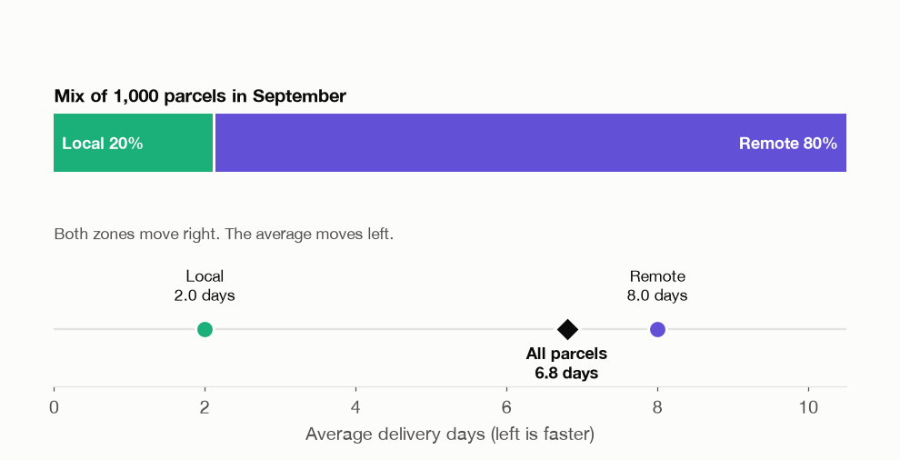
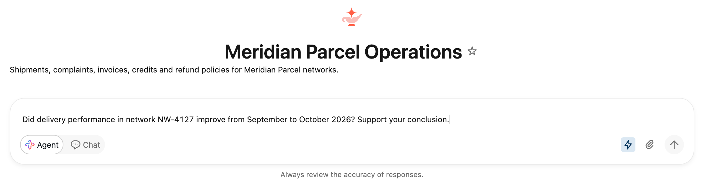
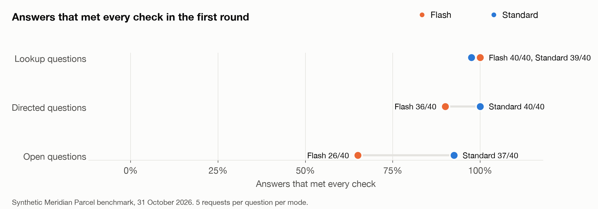

# Thinking, Fast and Slow with Databricks Genie

*Genie can now answer fast or slow. I tested when the slow answer is worth the wait.*

Praneeth Paikray, 31 October 2026

## One question, two answers

I asked Genie how shipment volume in one delivery network changed from September to October.

With Flash switched on, Genie answered in about 10 seconds. "Shipment volume in network NW-6731 decreased by 300 shipments, from 900 in September 2026 to 600 in October 2026."

With Flash switched off, Genie took 13 to 32 seconds and reached the opposite conclusion. The network's October data stops on 15 October. September had 30 shipments a day and October had 40, so volume went up.

Both answers came from the same agent reading the same data. The only difference was one button. I asked the question five times in each mode, and the answers split the same way every time. In one run, Flash even wrote that "October is essentially a complete month". It never checked.

## Fast and slow thinking

In *Thinking, Fast and Slow*, Daniel Kahneman describes two ways people think. System 1 is fast and automatic, and it answers from whatever is in front of it. System 2 is slow and takes effort, and it checks whether the first answer holds up. Most of the time System 1 is good enough. The trouble is that it does not notice when it is wrong. Kahneman calls this habit "what you see is all there is". System 1 builds the best story it can from the information it has, and it does not ask what is missing.

Genie Agent mode now has a version of both. If you switch on the lightning button next to Agent, you get [Flash](https://docs.databricks.com/aws/en/ai-bi/release-notes/2026), which spends less time reasoning and answers faster. If you leave it off, you get standard Agent mode, which takes longer and checks more. I will call them Flash and Standard.

Databricks [recommends Flash for simpler tasks](https://docs.databricks.com/aws/en/genie-agents/concepts). But the NW-6731 question looks simple, and nothing in it says that half of October is missing. So I wanted a practical answer. When is the fast answer enough, and when should I wait for the slow one?

## How I tested it

I made up a delivery company called Meridian Parcel and hid traps in its data. Each trap is a number that points the wrong way at first glance, plus one check that shows the truth. These are some of the traps:

- A month of data stops halfway.
- Every row for a month was loaded twice.
- An average falls only because the mix of parcels changed.

For each trap, I also built a control network where the first number is correct. A good answer should not invent a problem there.

I asked about each network in three ways:

- A lookup asks for one number.
- A directed question names the check, e.g., it asks for volume per day.
- An open question asks what a manager would ask, like the NW-6731 question, and leaves the check to Genie.

Over two rounds, I sent 480 requests, each in a fresh conversation. Before each round, I wrote down what a correct answer had to contain. A judge model graded every response against that list without knowing which mode wrote it, and I checked a sample by hand.

## When fast is enough

When the question named the check, Flash did as well as Standard. Both reached the right conclusion in all 40 directed responses in the first round. In the second round, Flash got 38 of 40 and Standard got 40. On first round lookups, Flash was perfect at 40 of 40.

This fits Kahneman's picture. System 1 does fine when someone points it at the right thing. If I ask Genie for volume per day, Flash computes volume per day. It does not need to work out that it should.

The one gap on directed questions came from detail, not from the conclusion. Flash sometimes gave the right answer without the numbers behind it.

## When the obvious number is wrong

The open questions are where the two modes split. In the second round, Flash reached the right conclusion on the partial month, duplicate and mix traps in 0 of 15 runs. Standard reached it in 10.

Flash usually ran one query and reported what it saw. When every October row had been loaded twice, Flash said volume "doubled" in all five runs. When a complaint rate rose overall but fell in both delivery zones, Flash said it got worse in all five runs. This is "what you see is all there is" in practice. The first query returns a plausible number, and nothing in the number says it is wrong.

Standard ran more queries before it answered. It checked the date range on NW-6731 in all five runs. On a delivery question in the first round, it split parcels into local and remote and found that both got slower, in four of five runs. The overall average had fallen from 6.8 days to 4.2 only because October shipped far more local parcels, which are quick to deliver. That is the animation at the top of this article.

The checks cost time. On the open questions in the second round, Flash took a median of 11 seconds and Standard took 26.

## Slow is not always right

Standard got 10 of those 15 trap runs right, not 15. It found the duplicate rows in only two of five runs.

It also overthought. One lookup asked only for two averages, and Standard added "Delivery time improved by 2.6 days month-over-month", which is the misreading the trap was built to catch. On a control where the complaint rate did get worse, Standard twice ran a significance test and declined to call it worse.

Standard also wrote more. Its median open answer in the first round had 233 words, against 63 for Flash, and the judge found 61 unsupported claims in Standard's answers against 30 in Flash's. More reasoning gave Standard more room to be useful and more room to be wrong.

## When neither can know

Some questions asked for things the data does not hold, e.g., how many customers had a problem and never complained. Both modes did badly. Flash passed 3 of 20 and Standard passed 5 of 20. Flash told me that "263 customers had a problem with an October 2026 delivery in network NW-1594 but never filed a complaint", which the data cannot know. Thinking longer did not help much here.

## So which one should you use?

Here is how I plan to choose:

- If I can name the check, I use Flash and put the check in the question. I also ask for the supporting numbers, because Flash tends to leave them out.
- If the obvious number could be wrong for a reason I have not thought of, I use Standard. Partial months, duplicate rows and shifts in mix are the cases where Flash failed in every open run.
- If the data might not hold the answer, I don't trust either mode until I check what the data contains.

In Kahneman's terms, Flash works like System 1, and the person asking can do the System 2 part. When you know what could go wrong, you can write the check into the question and get the fast answer. When you don't know what could go wrong, wait for Standard to look.

If you build Genie agents, you can also write the checks your users often need into the agent's instructions, e.g., checking that a month is complete. Flash might then make them too. I have not tested that yet.

## What this test can't tell you

The data is small and made up, and each trap has one designed check. The open questions are a small sample, so the size of the gap is uncertain, although Standard led in both rounds. One judge model graded every answer. I measured time, not cost. Flash is in Beta, so these results describe one day, 31 October 2026.

The data, questions, runner, raw responses and grades are in [github.com/Praneeth16/genie-flash-vs-standard](https://github.com/Praneeth16/genie-flash-vs-standard), so you can run the same test on your own Genie agent.

## Sources

1. Daniel Kahneman. Thinking, Fast and Slow. Farrar, Straus and Giroux, 2011.
2. [Databricks. AI/BI and Genie release notes 2026 (15 October 2026: Flash Beta).](https://docs.databricks.com/aws/en/ai-bi/release-notes/2026)
3. [Databricks. Genie Agents concepts (Flash and standard Agent mode).](https://docs.databricks.com/aws/en/genie-agents/concepts)

*Disclosure: I work at Databricks. Opinions here are my own. All data in this article is synthetic.*
